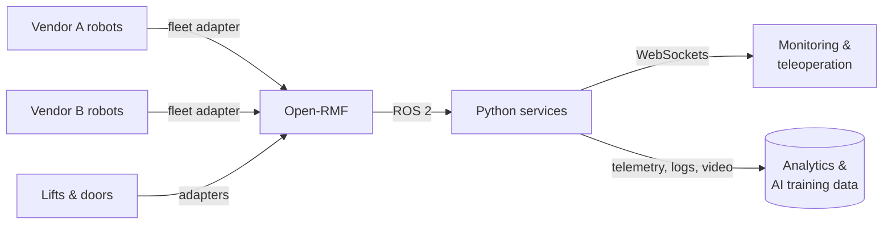

<picture>
  <source media="(prefers-color-scheme: dark)" srcset="./assets/header-dark.svg" />
  
</picture>

**Full-stack engineer for robot fleets — Open-RMF · ROS 2 · real-time Django/FastAPI backends · self-hosted AI**

---

### About me

I work in the hard middle of a system: the backend that keeps robots, people, and AI services talking to each other in real time.

- **Now:** Software Engineer at **LionsBot** and its subsidiary **[Griffin Labs](https://griffinlabs.ai)**. I build the **Building Intelligence** platform (middleware that lets robots from different vendors work together inside a building through **Open-RMF**), plus on-robot ROS 2 software: the operator panel, Nav2 mapping and localisation, and the ops platform behind them.
- **On the side:** a self-hosted, privacy-first homelab of AI and data apps, all reachable over Tailscale.
- **Education:** **NUS** B.Eng. (Engineering Science, Hons), Minor in Statistics, specialising in Computational Engineering.

**Ask me about:** real-time robot telemetry · Open-RMF fleet adapters · running LLMs locally · self-hosting with Tailscale

---

### What I build at work

Robots from different vendors speak different APIs. I build the layer that puts them on one map, one task queue, and one ops dashboard.

- Integrate vendor robot APIs with Open-RMF so mixed fleets share one orchestration workflow
- Real-time services for robot monitoring, teleoperation and remote intervention across global deployments
- Pipelines that turn robot telemetry, logs, video and sensor data into analytics and AI training data

---

### Featured projects

<table>
<tr>
<td valign="top">

#### 🧠 [ALENA](https://github.com/MinatoNami/project-alena)
**Local-first AI assistant with human-approved tools**

On-device LLM and Whisper, across web, CLI, voice and Telegram. A policy-controlled **MCP tool framework** with auto-discovery, native tool calling, approval gates and audit logs.

`Python · FastAPI · MCP · Whisper · Nuxt`

</td>
<td valign="top">

#### ❤️ [Health Exporter](https://github.com/MinatoNami/health-app)
**Personal health platform · 397 tests**

A SwiftUI app syncs **100+ Apple Health data types** to Django through idempotent NDJSON ingestion. Deterministic trend and anomaly analytics, plus a local LLM limited to 12 read-only tools with medical-safety rules.

`SwiftUI · HealthKit · Django · PostgreSQL`

</td>
</tr>
<tr>
<td valign="top">

#### 📚 [LumaIndex](https://github.com/MinatoNami/luma-index)
**Self-hosted PDF library · 505 tests**

Cross-device reading progress, full-text page search and annotations. Resumable uploads, content-addressed storage with dedup, and atomic deploys with health gates and rollback.

`Nuxt 3 · Django · PostgreSQL · PDF.js`

</td>
<td valign="top">

#### 🛡️ [Project Athena](https://github.com/MinatoNami/project-athena)
**Security investigation, human-controlled fixes · in progress**

Patrols codebases, hosts, containers and networks; checks whether a vulnerability *actually applies here*; and prepares evidence-backed remediation that a human approves.

`Python · FastAPI · Nuxt 4 · Docker`

</td>
</tr>
</table>

Health Exporter, LumaIndex and Athena share one home server, routed under a single tailnet address with a live status page by [alena-gateway](https://github.com/MinatoNami/alena-gateway).

---

### Experience

**Software Engineer — LionsBot International / Griffin Labs** · Jul 2026 – now 
Open-RMF multi-vendor fleets, teleoperation, telemetry pipelines; on-robot ROS 2 operator panel, Nav2 mapping and ops platform

**Software Lead — SenserBot** · Sep 2025 – Jul 2026 
Led Django/FastAPI services for autonomous robot fleets: real-time telemetry, video and alerts, speech-to-text and text-to-speech

**Field Applications Engineer — Living Optics** · Feb – Sep 2025 
Hyperspectral-imaging proof of concept for a Home Team security use case (Dimension X accelerator)

Earlier: frontend and full-stack roles at **UP DevLabs** (LLM customer-service platform) and **MarinaChain** (maritime emissions analytics). Full history on [LinkedIn](https://www.linkedin.com/in/lionel-chong).

---

### Tech stack

**Robotics & real-time**

   

**Backend, data & AI**

  

**Frontend & mobile**

